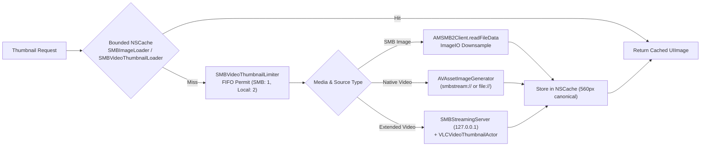
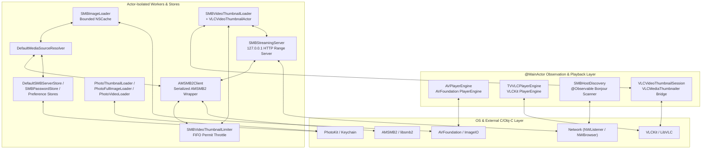
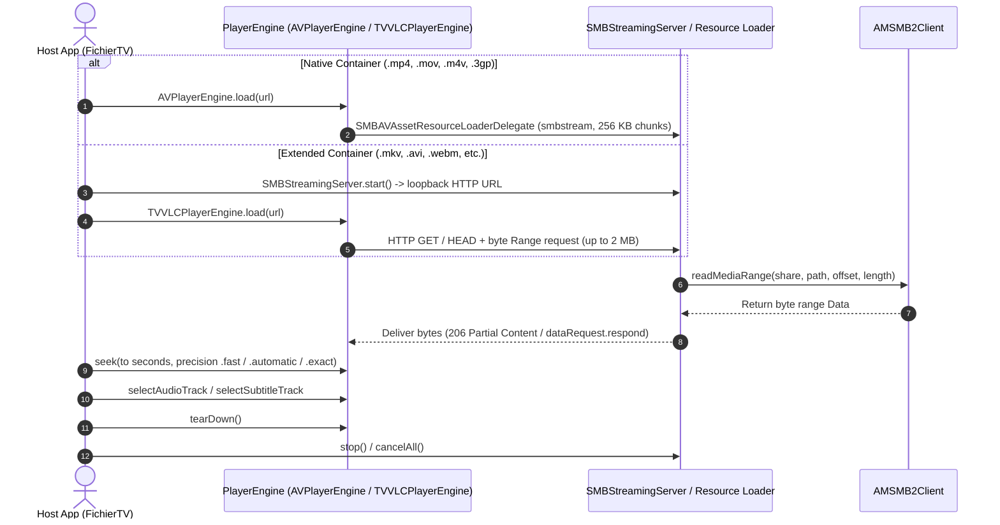

# FichierKit

**FichierKit** is the shared cross-platform Swift 6 core library powering **Fichier** (iOS, iPadOS, and tvOS). It provides unified media source abstractions (`MediaSource`), actor-isolated SMB2/SMB3 networking and Bonjour discovery, memory-bounded image and video thumbnailing, loopback HTTP byte-range streaming, and dual-engine video playback abstractions (`PlayerEngine`) across Apple `AVFoundation` and VideoLAN `VLCKit`.

Built cleanly in **Swift 6** language mode and structured around **Pure Swift Concurrency**, *FichierKit* enables responsive browsing and direct on-the-fly streaming of remote network media without staging full downloads to device storage.

---

## 🌟 Key Features

### 📡 Networking, SMB Discovery & Credentials
- **Serialized SMB2/SMB3 Client (`AMSMB2Client`)**: Actor-isolated wrapper around `AMSMB2` (`libsmb2`) conforming to [`SMBClientProtocol`](Sources/FichierKit/Protocols/SMBClientProtocol.swift), serializing socket operations via a concurrency permit limiter (`maxConcurrent: 1`) with automatic reconnect recovery and retry backoff on directory listings, full-prefix reads, and streaming byte-range reads.
- **Bonjour / mDNS Discovery (`SMBHostDiscovery`)**: `@Observable @MainActor` scanner implementing `SMBHostDiscoveryProtocol` using Apple's `Network` framework (`NWBrowser`) to discover `_smb._tcp` services on `local.` and resolve IPv4 addresses while preserving stable focus identifiers (`DiscoveredHost`).
- **Pre-Save Connection Validation (`DefaultSMBConnectionValidator`)**: Validates host formatting, authenticates credentials, and verifies accessible non-hidden shares prior to persisting server configurations.
- **Secure Credential & Server Persistence (`SMBPasswordStore`, `DefaultSMBServerStore`)**: Stores SMB credentials securely in the Apple Keychain (`kSecAttrAccessibleWhenUnlockedThisDeviceOnly`, with an isolated in-memory fallback for unsigned simulator/test targets) alongside server metadata in `UserDefaults`.

### 📁 Media Sources, Browsing & Preferences
- **Unified Media Source Protocol (`MediaSource`)**: Common asynchronous paginated interface (`fetchItems(in:sortBy:order:page:pageSize:)`) implemented by both:
  - **`PhotosMediaSource`**: PhotoKit smart albums (*Recents*, *Favorites*, *Videos*, *Screenshots*), user albums, and album assets with grid layout preference and date/name sorting.
  - **`SharesMediaSource`**: Remote SMB server shares and directory trees keeping folders sorted ahead of files across `.name` (Filename), `.date`, `.size`, and `.type` sort keys.
- **Source Resolution Cache (`DefaultMediaSourceResolver`)**: Resolves `"photos"` and persisted SMB server IDs into active `MediaSource` / `SMBClientProtocol` instances, with clean teardown (`invalidateSource(id:)`) on edit or removal.
- **52 Supported Media Extensions (`SupportedMediaTypes`)**:
  - **28 Image Formats**: Standard raster, animated, and high-efficiency formats (`jpg`, `jpeg`, `jpe`, `jif`, `jfif`, `png`, `heic`, `heif`, `webp`, `avif`, `gif`, `tiff`, `tif`, `bmp`, `ico`, `jp2`, `j2k`, `jpf`, `jpx`) plus Camera RAW (`cr2`, `cr3`, `nef`, `arw`, `dng`, `orf`, `rw2`, `pef`, `raf`).
  - **4 Native Video Formats (`AVPlayerEngine`)**: `mp4`, `mov`, `m4v`, `3gp`.
  - **20 Extended Video Formats (`TVVLCPlayerEngine`)**: `mkv`, `avi`, `webm`, `flv`, `f4v`, `wmv`, `asf`, `ts`, `m2ts`, `mts`, `m2v`, `mpg`, `mpeg`, `vob`, `ogv`, `rm`, `mxf`, `wtv`, `hevc`, `mjpeg`, with MIME resolution via `SupportedMediaTypes.mimeType(for:)`.
- **Per-Source Preference Stores**: Actor-isolated `UserDefaults` stores for per-source sorting (`DefaultMediaSortPreferenceStore`), grid/list view layout (`DefaultMediaLayoutPreferenceStore`), and slideshow settings (`DefaultSlideshowSettingsStore` defaulting to a `4.0s` interval and `.slide` transition).

### 🌐 Localization & String Catalog
- **Native Package String Catalog (`Localizable.xcstrings`)**: Embedded resource catalog configured with `defaultLocalization: "en"` in `Package.swift` providing complete translations across **11 languages** (`en`, `fr`, `de`, `es`, `it`, `ja`, `nl`, `pl`, `pt-PT`, `zh-Hans`, `zh-Hant`).
- **Type-Safe `LocalizedStringResource` Symbols**: Model descriptions and playback fallback strings resolve directly against `Bundle.module` via compiler-generated symbols:
  - **`SMBError`**: Localized error descriptions (`.smbErrorUnreachable`, `.smbErrorBadCredentials`, `.smbErrorTimeout`, `.smbErrorNoShares`, `.smbErrorShareNotFound`).
  - **`MediaSortKey`**: Localized display titles (`.sortKeyFilename`, `.sortKeyDate`, `.sortKeySize`, `.sortKeyType`).
  - **Playback Stream Fallbacks**: Localized fallback labels for unlabelled chapters (`.playerFallbackChapter`), audio tracks (`.playerFallbackAudioTrack`), and subtitle tracks (`.playerFallbackSubtitleTrack`, using accurate German `"Untertitelspur"` terminology).
  - **Slideshow Transitions**: Localized animation titles for `.slideshowTransitionFade` and `.slideshowTransitionSlide`.

### 📸 Image & Video Thumbnail Pipeline
- **Memory-Bounded SMB Image Loading (`SMBImageLoader`)**: Decodes and downsamples remote and local images via `ImageIO` (`CGImageSourceCreateThumbnailAtIndex`) into bounded `NSCache` tiers (`48 MB` / `120` thumbnails, `96 MB` / `8` 4K full-screen images up to `3840px`) without disk writes, respecting tvOS storage limits.
- **Dual-Backend Video Thumbnailing (`SMBVideoThumbnailLoader`)**:
  - **Native Videos**: Uses `AVAssetImageGenerator` directly over custom `smbstream://` URLs (`SMBAVAssetResourceLoaderDelegate`) or local file URLs with timeout racing.
  - **Extended Containers & Seek Previews**: Uses serialized LibVLC extraction (`VLCVideoThumbnailActor`, `VLCVideoThumbnailSession`) over `SMBStreamingServer` loopback HTTP URLs, supporting both relative timeline positions (`snapshotPosition`) and explicit timestamps (`snapshotTimeSeconds`).
  - **Concurrency & Scroll Protection**: Debounces rapid scroll requests (`50ms`), isolates SMB and local extraction behind FIFO `SMBVideoThumbnailLimiter` actors (`maxConcurrent: 1` for SMB, `2` for local), and shares a `560px` canonical master dimension (`standardMaxDimension`) across list rows and grid cards.
- **PhotoKit Asset Loaders (`PhotoThumbnailLoader`, `PhotoFullImageLoader`, `PhotoVideoLoader`)**: Asynchronous `PHCachingImageManager` loaders with cooperative task cancellation, video poster frame fallbacks, and automatic cleanup of temporary exported Slow-Mo / multi-segment `.mov` compositions (`> 30` minutes).



### 🎬 Dual-Engine Video Playback & Streaming
- **Unified Playback Protocol (`PlayerEngine`)**: `@MainActor` protocol unifying play/pause, seeking with explicit `PlayerSeekPrecision` (`.automatic`, `.exact`, `.fast`), playlist stepping, audio/subtitle track selection (`PlayerAudioTrack`, `PlayerSubtitleTrack`), embedded chapter discovery (`PlayerChapter`), and decoder teardown (`tearDown()`).
- **Native Engine (`AVPlayerEngine`)**: Wraps Apple's `AVPlayer` with `0.25s` periodic time observation, KVO `timeControlStatus` state mapping (`PlayerPlaybackState`), async `AVMediaSelectionGroup` track & localized chapter loading, and adaptive seek tolerance (`>= 5s`: `.positiveInfinity`, `>= 1s`: `0.5s`, `< 1s`: `.zero`).
- **Extended Engine (`TVVLCPlayerEngine`)**: Wraps VideoLAN's `VLCKit` (`VLCMediaPlayer`) for non-native containers and codecs, attaching a dedicated `UIView` render drawable (`renderView`), queuing seeks until `isSeekable`, reporting buffering transitions, and discovering LibVLC audio, subtitle, and title chapter streams.
- **Loopback HTTP Byte-Range Server (`SMBStreamingServer`)**: Pure Swift 6 `NWListener` on `127.0.0.1` handling `HEAD`, `206 Partial Content` (`HTTPRangeParser`, up to `2 MB` chunks), and `200 OK` full-body streaming (`512 KB` chunks) without temporary disk caching.
- **Custom AVFoundation Byte-Range Delegate (`SMBAVAssetResourceLoaderDelegate`)**: Serves `smbstream://` byte-range requests in `256 KB` chunks via `AMSMB2Client` and tracks in-flight requests through `SMBResourceLoadingTaskTracker` to cancel stale SMB reads immediately on scrub or teardown.
- **Playback Resume Store (`DefaultVideoPlaybackStore`)**: Actor-isolated resume position persistence ignoring early positions (`< 10s`) and automatically clearing progress near completion (within `15s` of duration).

---

## 🏗️ Architecture & Code Organization

The package adheres to two strict structural principles:
1. **One Definition (`class`, `struct`, `enum`, `actor`, `protocol`) = One File**: **64 modular Swift files** (`60` library source files across `Models`, `Protocols`, `Sources`, and `Storage` + `4` test and fixture files under `Tests/FichierKitTests/`).
2. **Pure Swift Concurrency**: Built on `Swift 6` strict concurrency (`actor`, `@MainActor`, `Sendable`, `async/await`, structured `TaskGroup`) with minimal `Sendable` isolation bridges where Apple's C/Obj-C APIs require dispatch queues (`NWBrowser`, `NWConnection`, `AVAssetResourceLoader`).

### Directory Structure

```
com.acme.swift.package.FichierKit/
│
├── Package.swift                                  # Swift 6.2 package manifest (iOS 18+, tvOS 18+)
├── Package.resolved                               # Pinned AMSMB2 & VLCKit dependencies
│
├── Sources/
│   └── FichierKit/
│       ├── Models/                                # 23 Sendable domain & state models
│       │   ├── DiscoveredHost.swift               # Bonjour-advertised SMB host record
│       │   ├── MediaFormatHelper.swift            # Byte-count and localized date formatters
│       │   ├── MediaItemType.swift                # folder / image / video item enum
│       │   ├── MediaSortKey.swift                 # Sort key enum (name, date, size, type)
│       │   ├── MediaSortOrder.swift               # Sort direction enum (ascending, descending)
│       │   ├── MediaSortPreference.swift          # Persisted sort key + order pair
│       │   ├── MediaSourceItem.swift              # Canonical item returned by MediaSource
│       │   ├── MediaSourceLayout.swift            # Grid vs List browser layout enum
│       │   ├── PhotosAuthorizationStatus.swift    # PhotoKit permission status enum
│       │   ├── PlayerAudioTrack.swift             # Audio track metadata model
│       │   ├── PlayerChapter.swift                # Embedded video chapter marker model
│       │   ├── PlayerEngineKind.swift             # Engine kind enum (native vs extended)
│       │   ├── PlayerPlaybackState.swift          # Discrete playback state enum
│       │   ├── PlayerSeekPrecision.swift          # Seek keyframe tolerance strategy enum
│       │   ├── PlayerSubtitleTrack.swift          # Subtitle / closed-caption track model
│       │   ├── SMBError.swift                     # Localized SMB connectivity & auth errors
│       │   ├── SMBServerFormModel.swift           # SMB connection form state & host normalization
│       │   ├── SavedSMBConnection.swift           # Persisted SMB connection configuration
│       │   ├── ServerCardItem.swift               # tvOS SMB server card display model
│       │   ├── ServerConnectionStatus.swift       # Online / Offline / Connecting / Unknown status
│       │   ├── SlideDirection.swift               # Photo transition direction enum
│       │   ├── SlideshowTransitionStyle.swift     # Slideshow animation style enum (fade, slide)
│       │   └── SupportedMediaTypes.swift          # 52 image/video extensions & MIME lookup
│       │
│       ├── Protocols/                             # 11 Sendable service & store abstractions
│       │   ├── MediaLayoutPreferenceStoreProtocol.swift # Per-source layout preference contract
│       │   ├── MediaSortPreferenceStoreProtocol.swift   # Per-source sort preference contract
│       │   ├── MediaSource.swift                  # Paginated media backend abstraction
│       │   ├── MediaSourceResolverProtocol.swift  # Source resolution & invalidation contract
│       │   ├── PlayerEngine.swift                 # Unified AVPlayer / VLCKit playback contract
│       │   ├── SMBClientProtocol.swift            # SMB share, directory, file & range contract
│       │   ├── SMBConnectionValidatorProtocol.swift # Pre-save credential & share check contract
│       │   ├── SMBHostDiscoveryProtocol.swift     # Bonjour host discovery contract
│       │   ├── SMBServerStoreProtocol.swift       # Server metadata & reachability contract
│       │   ├── SlideshowSettingsStoreProtocol.swift # Slideshow interval & transition contract
│       │   └── VideoPlaybackStoreProtocol.swift   # Video resume timestamp contract
│       │
│       ├── Sources/                               # 10 media backends, networking & player engines
│       │   ├── AMSMB2Client.swift                 # Actor-isolated libsmb2 / AMSMB2 SMB client
│       │   ├── AVPlayerEngine.swift               # Native AVFoundation PlayerEngine implementation
│       │   ├── DefaultMediaSourceResolver.swift   # Default MediaSource & SMB client resolver actor
│       │   ├── DefaultSMBConnectionValidator.swift # AMSMB2-backed connection & share validator
│       │   ├── HTTPRangeParser.swift              # HTTP Range: bytes=... parser
│       │   ├── PhotosMediaSource.swift            # PhotoKit album & asset MediaSource backend
│       │   ├── SMBHostDiscovery.swift             # NWBrowser Bonjour (_smb._tcp) IPv4 scanner
│       │   ├── SMBStreamingServer.swift           # Pure Swift 6 127.0.0.1 HTTP range streamer
│       │   ├── SharesMediaSource.swift            # SMB share & directory MediaSource backend
│       │   └── TVVLCPlayerEngine.swift            # LibVLC / VLCKit PlayerEngine implementation
│       │
│       └── Storage/                               # 16 persistence stores, caches & loaders
│           ├── DefaultMediaLayoutPreferenceStore.swift # UserDefaults layout store actor
│           ├── DefaultMediaSortPreferenceStore.swift   # UserDefaults sort preference store actor
│           ├── DefaultSMBServerStore.swift        # Saved SMB connections & reachability probe actor
│           ├── DefaultSlideshowSettingsStore.swift # UserDefaults slideshow settings store actor
│           ├── DefaultVideoPlaybackStore.swift    # UserDefaults video resume store actor
│           ├── PhotoFullImageLoader.swift         # Full-resolution (4K) PhotoKit image loader actor
│           ├── PhotoThumbnailLoader.swift         # PhotoKit thumbnail & video poster actor
│           ├── PhotoVideoLoader.swift             # PhotoKit playable URL / Slow-Mo exporter actor
│           ├── SMBAVAssetResourceLoaderDelegate.swift # Custom smbstream:// AVAsset loader delegate
│           ├── SMBImageLoader.swift               # Bounded NSCache SMB & local image decoder actor
│           ├── SMBPasswordStore.swift             # Keychain credential store actor
│           ├── SMBResourceLoadingTaskTracker.swift # Task cancellation registry for resource loader
│           ├── SMBVideoThumbnailLimiter.swift     # FIFO concurrency limiter actor
│           ├── SMBVideoThumbnailLoader.swift      # Native & VLC video thumbnail generator actor
│           ├── VLCVideoThumbnailActor.swift       # Serialized LibVLC thumbnailer actor with watchdog
│           └── VLCVideoThumbnailSession.swift     # @MainActor VLCMediaThumbnailer delegate bridge
│
└── Tests/
    └── FichierKitTests/                           # 4 test & fixture files (28 tests in 2 suites)
        ├── FichierKitTests.swift                  # Sources, models, sorting, stores, streaming & engine tests
        ├── MockSMBClient.swift                    # Sendable in-memory SMBClientProtocol mock
        ├── SMBVideoThumbnailTests.swift           # Native/VLC thumbnail, loopback HTTP & limiter tests
        └── VideoTestFixtureGenerator.swift        # H.264 .mp4 AVAssetWriter test fixture builder
```

### Concurrency Architecture



### Dual-Engine Playback & Loopback Streaming



---

## 📦 Dependencies & Requirements

### Platform Requirements
- **iOS 18.0+** / **tvOS 18.0+**
- **Swift 6.0** language mode (`swift-tools-version: 6.2`)

### External Dependencies
- **[AMSMB2](https://github.com/amosavian/AMSMB2.git)** (`>= 4.0.3`):
  Swift wrapper around `libsmb2`, providing SMB2 and SMB3 client connectivity over TCP port 445.
- **[VLCKit](https://github.com/videolan/vlckit.git)** (`exact: 4.0.0-a25`):
  VideoLAN LibVLC framework powering extended container decoding (`TVVLCPlayerEngine`) and keyframe thumbnail extraction (`VLCVideoThumbnailActor`).

### Apple Native Frameworks
- `Foundation`: Value types, URLs, `UserDefaults` storage, and localization formatting.
- `Network`: `NWBrowser` for Bonjour SMB discovery and `NWListener` / `NWConnection` for loopback HTTP range streaming.
- `AVFoundation`: `AVPlayer`, `AVURLAsset`, `AVAssetResourceLoaderDelegate`, `AVAssetImageGenerator`, and `AVAssetExportSession`.
- `Photos`: `PHAsset`, `PHAssetCollection`, and `PHCachingImageManager` for album/asset browsing and loading.
- `ImageIO` & `UniformTypeIdentifiers`: Downsampled image decoding and MIME/`UTType` resolution.
- `Security`: Keychain Services API (`SecItemCopyMatching`, `SecItemAdd`, `SecItemUpdate`, `SecItemDelete`) for credential storage.
- `CoreVideo`: Test fixture video frame synthesis (`CVPixelBuffer`).
- `UIKit`, `Observation`, & `OSLog`: UIKit render surfaces/`UIImage` types, `@Observable` discovery state, and structured logging.

### Host App Privacy & Entitlements (`Info.plist`)
Host applications integrating `FichierKit` features should declare:
- `NSLocalNetworkUsageDescription`: Explains local network access when using `SMBHostDiscovery` or `AMSMB2Client`.
- `NSBonjourServices`: Declares `_smb._tcp` when scanning via `SMBHostDiscovery`.
- `NSPhotoLibraryUsageDescription`: Required when accessing PhotoKit albums and assets through `PhotosMediaSource` or `Photo*Loader` actors.

---

## 🛠️ Integration, Building & Testing

1. Add **FichierKit** as a local or remote Swift Package dependency in `Package.swift` or Xcode:
   ```swift
   dependencies: [
       .package(url: "https://github.com/NivekAlunya/com.acme.swift.package.FichierKit.git", branch: "main")
   ]
   ```
   *(For local workspace development alongside **Fichier**, `fichier.xcodeproj` references `../library/com.acme.swift.package.FichierKit` directly.)*
2. Import the module where needed:
   ```swift
   import FichierKit
   ```
3. Run the unit test suite (**28 tests in 2 suites**: `FichierKitTests` and `SMBVideoThumbnailTests`) against an iOS or tvOS Simulator:
   ```bash
   xcodebuild test -scheme FichierKit -destination "platform=tvOS Simulator,name=Apple TV 4K (3rd generation)"
   ```
